# Chemical Skull Modification & Stimulation Model

> **仓库总入口 · 全部更新内容已并入 `main`**
> 本仓库把四轮成果收进同一个框架：三路线模型 → 全指标实算 → 按试剂分段拟合 → 顶层研究设计。
> 所有模型均为**矫正后**模型；未矫正的纯机理探索、原始 LHS 结果、旧 `corrected_models/`
> 已从 `main` 移除（仍在 Git 历史，可恢复）。拟合图统一放在 `*/figures/` 下。

| 层 | 内容 |
|---|---|
| **预测对象** | **TrackA** 点预测：具体阻抗降低值 `R_Z`（等价 `Δ = 1 − R_Z`）；**TrackB** 区间预测：阻抗降低区间 `[lo, hi]` |
| **TrackA 三路线** | A1 纯经验（灵活性上界）/ A2 纯机理（可解释性下界，4 个全物理参数）/ A3 机理驱动经验（机理定形状 + 受约束保形校准） |
| **对比维度 ①** | 全局拟合 vs 按试剂分段拟合（分段独立 `SEG` / 骨架保留增量 `ADJ`） |
| **对比维度 ②** | 所有条件 C1 vs **最佳条件范围 C4**（0.15/0.20 M × 100/120 Hz） |
| **唯一验收口径** | `LORO` 留一大鼠（个体级独立验证）；TrackB 只报 coverage / width / Winkler |
| **设计动因** | 生物机理不可能完备 → 需 A2 作可解释基准；数据量有限（24 鼠 / 96 条件节点）→ 纯经验易过拟合 → 需 A1 作灵活基准；二者折中即 A3；个体差异不可约 → 另设 TrackB 区间 |

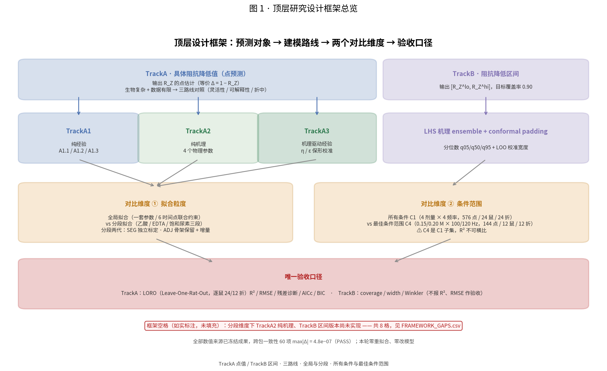

---

## 0. 拟合效果最好的是哪一种（先给结论）

**按项目既定、唯一算数的验收口径 `LORO`（Leave-One-Rat-Out，逐鼠独立验证）：全局 TrackA3「机理驱动经验」最好。**
它在四个条件下都是五模型第一，且不是靠参数最多取胜（A3 仅 6 个参数，`η=1, ε=0` 时退化为 A2）。

| 条件 | A1.1 | A1.2 | A1.3 | A2 | A3 | 最优 |
|---|---|---|---|---|---|---|
| C1 全部条件 | 0.4806 | 0.4738 | 0.4758 | 0.4865 | 0.5201 | **0.5201** |
| C2 低频 | 0.7141 | 0.6557 | 0.6584 | 0.7088 | 0.7326 | **0.7326** |
| C3 高浓度 | 0.5907 | 0.5731 | 0.5671 | 0.6014 | 0.6408 | **0.6408** |
| C4 最佳范围 | 0.7389 | 0.6801 | 0.6840 | 0.7397 | 0.7684 | **0.7684** |

| 条件 | A3 LORO R² | A3 LORO RMSE | 次优 A2 LORO R² | 领先幅度 |
|---|---|---|---|---|
| C1 全部条件 | **0.5201** | 0.1955 | 0.4865 | +0.0336 |
| C2 低频 | **0.7326** | 0.1046 | 0.7088 | +0.0238 |
| C3 高浓度 | **0.6408** | 0.1476 | 0.6014 | +0.0394 |
| C4 最佳范围 | **0.7684** | 0.0927 | 0.7397 | +0.0287 |

**为什么是 A3**：A2 的 `δ_eff` 机理骨架把频率、剂量、时间都写进方程，定住了曲线形状（`R_Z = 1/(1+δ_eff)`，
基线天然为 1、4 个参数、零经验回归层）；A3 只再叠两个受约束的保形校准系数 `η, ε`，用很小的自由度修正
整体幅度与时间漂移。纯经验 A1 系列在收窄条件下样本内很漂亮，但逐鼠泛化最差；A2 一套 C1 参数**零重拟合**
迁移到 C2/C3/C4 仍有 R² ≈ 0.947 / 0.932 / 0.953，说明机理骨架确实抓住了跨条件结构。

### 若只看「拟合程度数值」（`full`，群体均值层 in-sample，仅参考、**不作验收**）

| 条件 | A1.1 | A1.2 | A1.3 | A2 | A3 |
|---|---|---|---|---|---|
| C1 全部条件 | 0.9094 | 0.8815 | 0.8652 | 0.9185 | 0.9205 |
| C2 低频 | 0.9623 | 0.8728 | 0.8672 | 0.9534 | 0.9573 |
| C3 高浓度 | 0.9356 | 0.8943 | 0.8628 | 0.9457 | 0.9460 |
| C4 最佳范围 | 0.9824 | 0.8955 | 0.8847 | 0.9780 | 0.9795 |

分段方案在样本内更贴：C1 下 `SEG_A1` full R² = **0.9573**、`SEG_A3` = **0.9538**，
高于全局 A3 的 0.9205；C4 下 `SEG_A1` 达 0.9918。但这是**样本内 + 条件收窄 + 参数由 6 增到 11/13**
共同抬高的结果，其 LORO 反而显著变差（见第 3 节）。**`full` 只描述曲线贴合，不能当验收成绩单**。

### 分段方案里唯一没退步的

`ADJ_A3`（在 TrackA3 上做骨架保留 + 尿素界面重构）：C1 LORO R² = **0.5226**，
ΔR² = +0.0025，配对 bootstrap 95% CI **[-0.0085, 0.0123] 跨 0** → 统计上只能说**不劣于**全局 A3，
**不能写成「更好」**。它真正补上的是机理缺口：`t=105` 尿素段实测 `R_Z` 由 0.207 回升到 0.267（Δ=+0.060），
5 个全局单调模型全部预测继续下降（**0/16** 节点符号一致），而全部分段方案 **16/16** 一致。

### TrackB 不与 TrackA 横比

TrackB 预测的是区间而非点值，对象不同、成绩单不同（coverage / width / Winkler），
不存在「和 A3 谁拟合更好」的问题。四条件 coverage 全部达标（0.9082 /
0.9133 / 0.9457 / 0.9783）。

> **一句话**：按验收口径选 **全局 TrackA3**；若只追求样本内曲线最贴，`SEG_A1`/`SEG_A3` 数值更高但
> **不可作为验收模型**；分段里唯一可接受的替代是 `ADJ_A3`（表述为「不劣于」，不是「更好」）。

---

## 1. 三路线模型目录

| 路线 | 目录 | 内容 | 机理含量 | k |
|---|---|---|---|---:|
| **TrackA1 纯经验** | `TrackA1/A1.1` `A1.2` `A1.3` | 拉伸指数 / A+ 协变量 / H1 混合 | 无 ~ 低（机理先验仅作特征） | 5 / 4 / 3 |
| **TrackA2 纯机理** | `TrackA2/` | 并联导纳 + 脱钙动力学，**频率内生** | 100%（4 个全物理参数） | 4 |
| **TrackA3 机理驱动经验** | `TrackA3/` | A2 骨架 + `η, ε` 保形校准 | 骨架 100% + 经验校准 | 6 |
| **TrackB 区间** | `TrackB/` | LOO 校准区间（392 点全频 + 196 点低频） | 机理 ensemble + conformal padding | — |

机理原理唯一权威总纲：[`docs/MECHANISM_PRINCIPLE.md`](docs/MECHANISM_PRINCIPLE.md)
（EDTA 脱钙 → Archie 电导 → 串联积分归一化 → CPE/并联导纳 → `δ_eff` 推导 → 参数可辨识性 → 逐模型溯源 → 数值对照 → 诚实边界 → 符号量纲总表）。

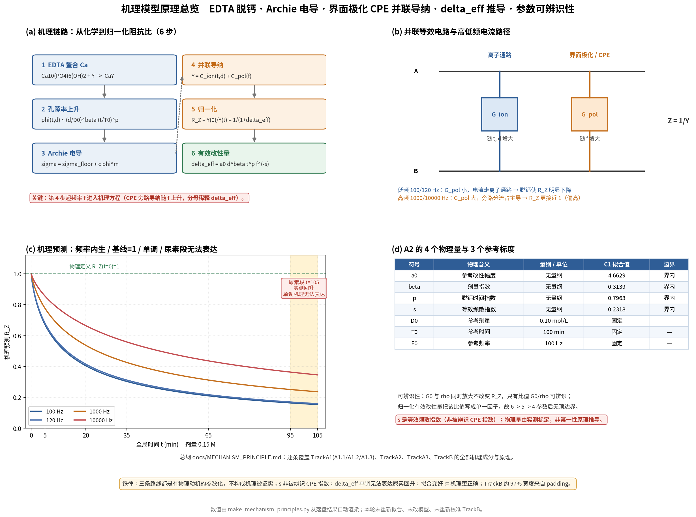

---

## 2. 四条件与验收口径

| 条件 | 剂量 (M) | 频率 (Hz) | 条件节点 | 逐鼠点 | 鼠数 | LORO 折数 |
|---|---|---|---|---|---|---|
| C1 全部条件 | 0.05 / 0.10 / 0.15 / 0.20 | 100 / 120 / 1000 / 10000 | 96 | 576 | 24 | 24 |
| C2 低频 | 0.05 / 0.10 / 0.15 / 0.20 | 100 / 120 | 48 | 288 | 24 | 24 |
| C3 高浓度 | 0.05 / 0.10 / 0.15 / 0.20 | 100 / 120 / 1000 / 10000 | 48 | 288 | 12 | 12 |
| C4 最佳范围 | 0.05 / 0.10 / 0.15 / 0.20 | 100 / 120 | 24 | 144 | 12 | 12 |

> C4 是 C1 的**子集**（144 点 / 12 鼠 / 12 折 vs 576 / 24 / 24）。评价集不同，
> **四条件 R² 不可横向比大小**；条件收窄带来的 R² 上升不等于模型变好。

验证层级：`full`（样本内，仅参考）< `LOCO`（群体条件均值层）< **`LORO`（个体级独立验证，唯一验收口径）**。
评价标准唯一权威清单：[`docs/EVALUATION_CRITERIA.md`](docs/EVALUATION_CRITERIA.md)
（A 验证层级 8 条 / B 点预测 12 条 / C 区间 9 条 / D 绘图 6 条 / E 铁律 10 条，共 45 条）。

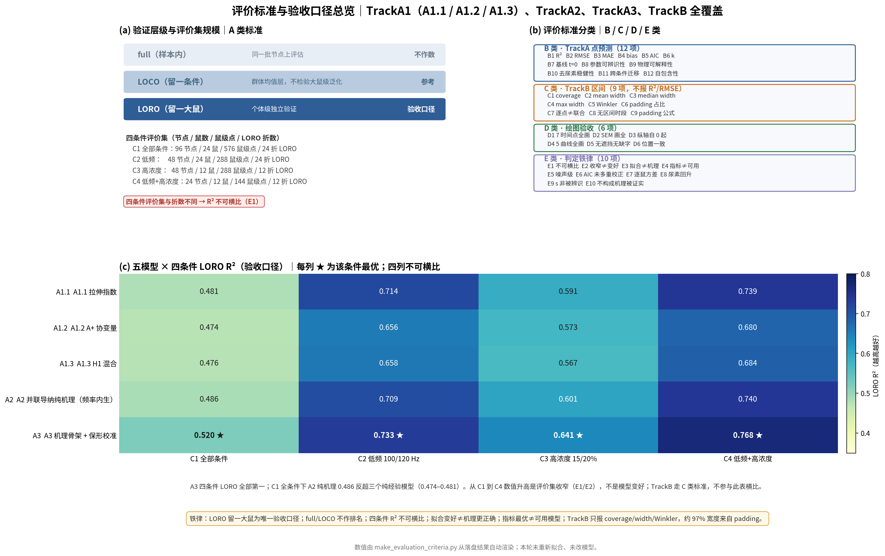

---

## 3. 全局拟合 vs 按试剂处理分段拟合

Excel 官方试剂标签：50% 乙酸 `t=5` → EDTA 四时间点 `t=20/35/65/95` → 乙醇+饱和尿素 `t=105`（另有基线 `t=0`）。
三段各 288 / 1152 / 288 行，24 鼠全保留。分段两代：

- `SEG_A1` / `SEG_A3`：**三段从零独立标定**，每段可改公式（A1 每段 2–3 个候选按 LORO 择优；A3 共用 `δ_eff` 骨架 + 乙酸酸蚀 / EDTA 脱钙 / 尿素界面重构再封闭）。
- `ADJ_A1` / `ADJ_A3`：**保留全局骨架 + 最少分段增量**，尿素段从 `t=95` 末态平台出发做跃变。

| 条件 | 方案 | k | full R²* | **LORO R²** | LORO RMSE | ΔR² vs A3 | 配对 bootstrap 95% CI |
|---|---|---|---|---|---|---|---|
| C1 全部条件 | BASE_A3 | 6 | 0.9205 | 0.5201 | 0.1955 | —（基线） | — |
| C1 全部条件 | SEG_A1 | 11 | 0.9573 | 0.4963 | 0.2003 | -0.0239 | [-0.0431, -0.0115] |
| C1 全部条件 | SEG_A3 | 13 | 0.9538 | 0.4944 | 0.2007 | -0.0258 | [-0.0489, -0.0101] |
| C1 全部条件 | ADJ_A1 | 10 | 0.9190 | 0.4827 | 0.2030 | -0.0374 | [-0.0534, -0.0200] |
| C1 全部条件 | ADJ_A3 | 11 | 0.9353 | 0.5226 | 0.1950 | +0.0025 | [-0.0085, 0.0123] |
| C4 最佳范围 | BASE_A3 | 6 | 0.9795 | 0.7684 | 0.0927 | —（基线） | — |
| C4 最佳范围 | SEG_A1 | 11 | 0.9918 | 0.7294 | 0.1002 | -0.0391 | [-0.0697, -0.0113] |
| C4 最佳范围 | SEG_A3 | 13 | 0.9917 | 0.7308 | 0.1000 | -0.0377 | [-0.0648, -0.0105] |
| C4 最佳范围 | ADJ_A1 | 10 | 0.9867 | 0.7358 | 0.0990 | -0.0327 | [-0.0539, -0.0083] |
| C4 最佳范围 | ADJ_A3 | 11 | 0.9848 | 0.7670 | 0.0930 | -0.0014 | [-0.0177, 0.0238] |

\* `full` 为群体均值层 in-sample，**仅参考、不作验收**。

**判读**：只有 `ADJ_A3` 的 ΔR² 置信区间跨 0（不显著、持平）；`SEG_A1`/`SEG_A3`/`ADJ_A1` 的 CI 全在 0 左侧，
在 LORO 下**显著变差**，且 AICc / BIC 全部恶化。误差主体是**鼠间异质性**（单段横截面 R² 仅 0.13–0.20），
分段消除的是系统偏差而非方差——这正是「群体均值层提升 ≠ 个体验证提升」的铁律。

分段真正修好的两件事：**尿素回升 16/16 节点符号一致**（全局单调 0/16）；**段内系统偏差归零**
（A3 原乙酸段 bias −0.050、尿素段 +0.038）。

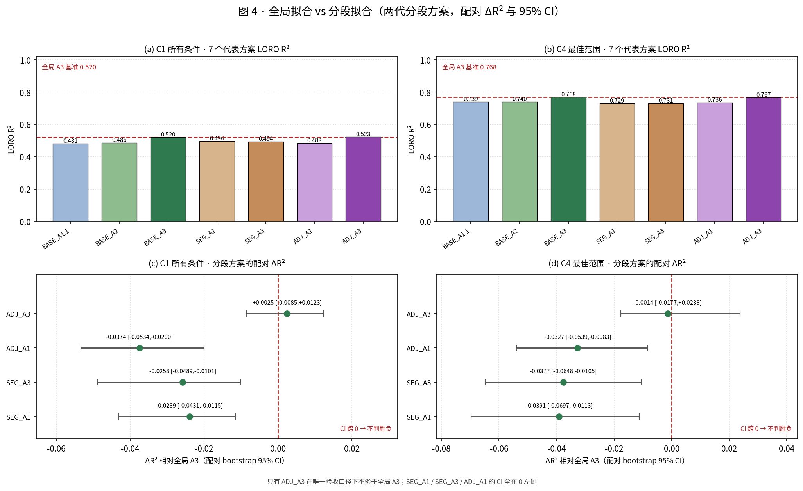
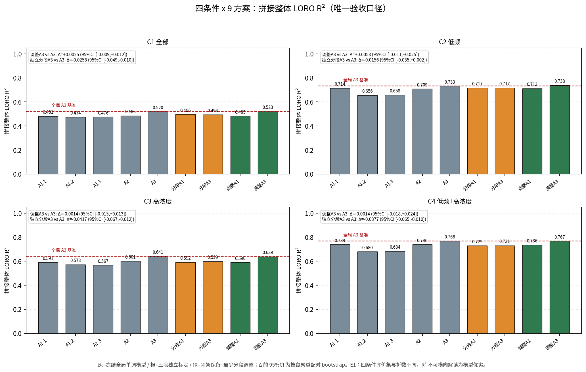
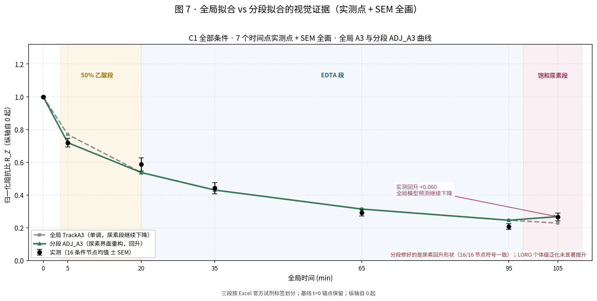

详见 [`segmented_fit/SEGMENTED_CONCLUSION.md`](segmented_fit/SEGMENTED_CONCLUSION.md)
与 [`segmented_fit/SEGMENTED_MODELS.md`](segmented_fit/SEGMENTED_MODELS.md)。

---

## 4. 所有条件 vs 最佳条件范围

A3 LORO R² 由 C1 的 0.5201 升到 C4 的 **0.7684**，
TrackB coverage 由 0.9082 升到 **0.9783**。
但 C4 是 C1 子集、评价集与折数都不同，**这两组数只能描述「可预测性差异」，不能解读为模型变好**。

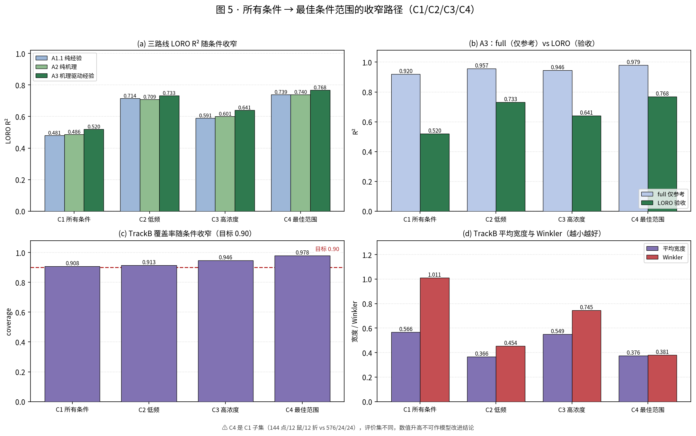

---

## 5. TrackB 区间预测

| 条件 | 区间点数 | **coverage** | 平均宽度 | Winkler (α=0.10) |
|---|---|---|---|---|
| C1 全部条件 | 392 | 0.9082 | 0.5662 | 1.0113 |
| C2 低频 | 196 | 0.9133 | 0.3662 | 0.4538 |
| C3 高浓度 | 184 | 0.9457 | 0.5491 | 0.7445 |
| C4 最佳范围 | 92 | 0.9783 | 0.3763 | 0.3814 |

- 校准公式 `calibrated_lower = clip(sim_q05 − p, 0, 1)`、`calibrated_upper = clip(sim_q95 + p, 0, 1)`，
  `p_(fold,f) = tolerance_f × q_f`；Winkler `α_mis = 0.10`。
- **约 97.09% 的区间宽度来自 conformal padding**，不是 LHS 采样范围不足；
  统计证据是残差强非正态（Shapiro p = 5.73e−29）、厚尾（超额峰度 23.566）、
  正自相关（DW = 0.911）、异方差（BP p = 3.96e−04）。
- **TrackB 不报 R² / RMSE 作验收**；区间中心点的点指标已在全指标总表第 6.2 节算出但逐行标注
  `DIAGNOSTIC_ONLY`。逐点覆盖率 ≠ 整条曲线联合覆盖概率。

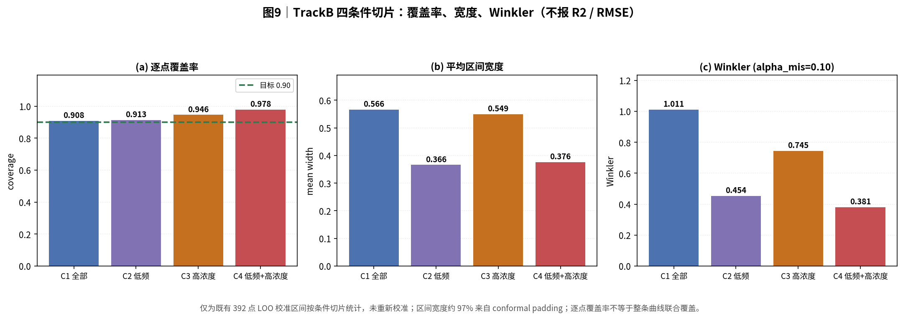

---

## 6. 全评价标准实算（R² / RMSE / 残差等全部算成数值）

**唯一权威数值总表：[`docs/ALL_METRICS_COMPUTED.md`](docs/ALL_METRICS_COMPUTED.md)**

- **60 组 × 75 个指标**（5 模型 × 4 条件 × 3 验证层级）：`four_conditions/ALL_METRICS_FULL.csv`
- **8640 行逐点残差**：`four_conditions/RESIDUALS_LONG.csv`（观测 / 预测 / 残差 / 标准化残差 / 百分比误差）
- 指标族：调整 R²、NRMSE、MSE/SSE/SST、MedAE/MaxAE/MAPE/sMAPE/MPE；完整残差分布与
  Shapiro–Wilk / Jarque–Bera / D'Agostino / Anderson–Darling / Durbin–Watson / Breusch–Pagan / White；
  AICc / BIC / logLik；Pearson / Spearman / Lin CCC；校准回归；Theil U1/U2、Willmott d；MSE 三分解；
  按鼠整簇 bootstrap 95% CI
- 45 条标准逐条回填 `STANDARDS_COMPUTED.csv`、E 类铁律数值证据 `IRONLAW_EVIDENCE.csv`、
  补算 B10 去尿素稳健性（**0/4** 条件 LORO 第一名翻转，仍为 A3）
- **零改动校验 PASS**：60 项复算与冻结值 max|ΔR²| = 4.777e−07、max|ΔRMSE| = 4.746e−07

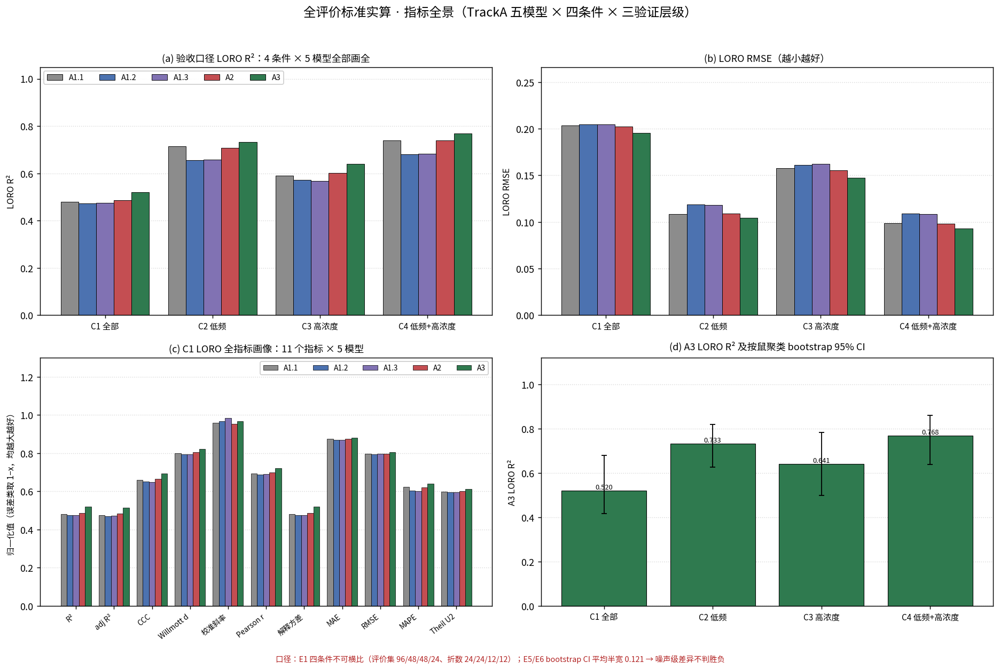
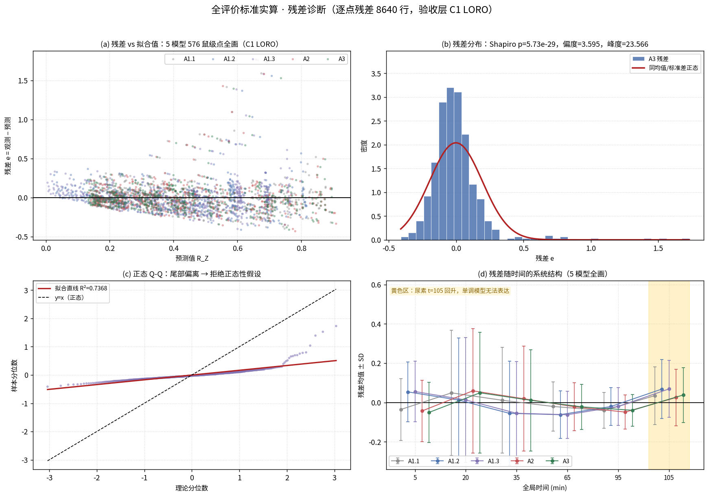

---

## 7. 顶层研究设计整合层（本轮新增）

| 目录 | 内容 |
|---|---|
| [`research_design/RESEARCH_DESIGN.md`](research_design/RESEARCH_DESIGN.md) | **顶层设计总纲**（唯一权威）：对象二分、三路线设计论证、两对比维度、验收口径、边界与空格 |
| [`research_design/COMPARISON_MATRIX.md`](research_design/COMPARISON_MATRIX.md) | 全维度对比数值展开 |
| `research_design/tables/MASTER_COMPARISON.csv` | **136 行 × 30 列**统一主表 + 13 张分组表 |
| [`segmented_fit/`](segmented_fit/README.md) | 分段拟合包：三段公式、两代方案、8 张图、12 张实算表 |
| `docs/PUSH_RECEIPT.md` | 本轮覆盖推送回执（commit、文件数、校验结果） |

跨包一致性校验 **60 项逐项比对 max|Δ| = 4.800e−07，PASS** —— 模型公式、参数、数据一律未改，零重拟合。

### 必须诚实标注的空格子

框架 2×2 里有 **8 个格子是空的**：分段维度下的 **TrackA2 纯机理** 与 **TrackB 区间** 都没有实现版本
（分段任务只在 TrackA1 / TrackA3 上做；TrackB 只是按条件切片，未做分段重建/重新校准）。
见 `research_design/tables/FRAMEWORK_GAPS.csv`，**未拿近似值填充**。

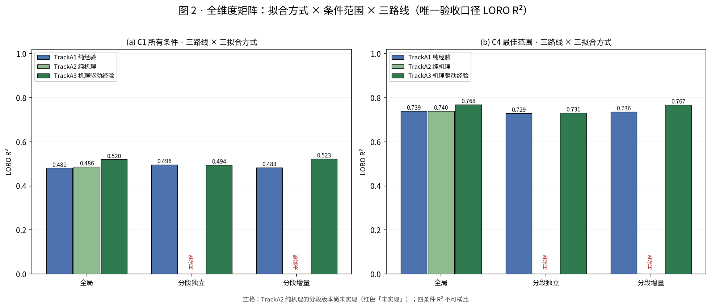

---

## 8. 拟合效果图索引

| 图 | 内容 |
|---|---|
| `four_conditions/figures/fig1`–`fig5` | 四条件 × 五模型完整拟合图（7 时间点 + SEM 全画、纵轴自 0 起） |
| `four_conditions/figures/fig6_routes_loro.png` | 三路线五模型四条件 LORO 汇总 |
| `four_conditions/figures/fig7` / `fig8` | A2 频率内生曲面 / 三路线架构 |
| `four_conditions/figures/fig9` / `fig10` | TrackB 四条件 / 表 1 完整指标 |
| `four_conditions/figures/fig11` / `fig12` | 评价标准总览 / 机理原理总览 |
| `four_conditions/figures/fig13`–`fig15` | 全指标全景 / 残差诊断 / TrackB 与标准回填 |
| `segmented_fit/figures/fig01`–`fig08` | 分段实测 / 变体择优 / 拟合曲线 / LORO 对比 / 尿素回升 / 两种口径分离 / 残差 |
| `research_design/figures/fig01`–`fig07` | 设计框架 / 矩阵 / 三路线 / 全局vs分段 / 条件收窄 / TrackB 与回升 / 分段曲线 |


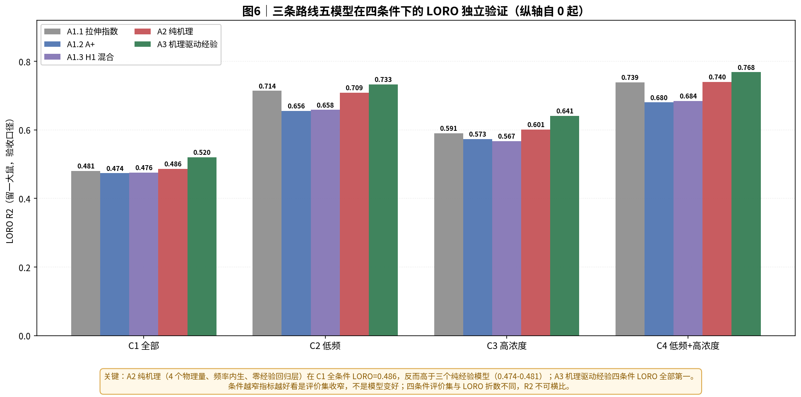

---

## 9. 口径铁律（务必阅读）

1. **三条路线都是「有物理动机或数据动机的参数化」，不构成机理被证实**。A2 的物理参数由实测标定，
   不是从第一性原理推导；`s` 是等效频散指数，不是被辨识的 CPE 指数；`ρ` 是等效再封闭率。
2. `LORO` 是**唯一验收口径**；`full` / `LOCO` 是群体均值层，**不可与个体验证混淆**。
3. 四条件评价集与折数不同，**R² 不可横向解读为模型优劣**；条件收窄 ≠ 模型变好。
4. **拟合变好 ≠ 机理更正确**；**指标最优 ≠ 可用模型**；bootstrap CI 平均半宽 0.121，
   远大于同条件内模型间差 0.019–0.039 → 噪声级差异不判胜负。
5. **TrackB 只报 coverage / width / Winkler，不报 R² / RMSE**；逐点覆盖 ≠ 整曲线联合覆盖；
   宽度约 97% 来自 conformal padding 而非 LHS 不确定性。
6. 基线 `t=0` 按物理定义 `R_Z=1`：A1.1 / A1.3 / A2 / A3 天然满足，**A1.2 (A+) 需人为锚定**。
7. 数据：修订版《体外EDTA数据记录汇总.xlsx》SHA `4c165298...`，三层核验见 `data/data_verification.json`。
   保留全部 24 鼠，**未删除 WT17 / WT9 / WT8 等不利样本**。
8. 分段变体择优属**同一数据集内的探索性选择**；框架空格子如实标注，不填充近似值。

完整定义、公式、优先级与逐模型数值见 [`docs/EVALUATION_CRITERIA.md`](docs/EVALUATION_CRITERIA.md)。

---

## 10. 复现

```bash
pip install -r requirements.txt

# (1) 三路线四条件拟合 + 全指标实算 + 评价标准/机理原理总纲
cd four_conditions
python run_three_routes.py
python make_figures.py
python make_evaluation_criteria.py
python make_mechanism_principles.py
python compute_all_metrics.py
python make_all_metrics_figures.py
python make_all_metrics_docs.py
cd ..

# (2) 按试剂分段拟合（自包含，数据在 segmented_fit/data/）
cd segmented_fit
python segmented_fit.py && python make_figures.py && python make_docs.py
cd ..

# (3) 顶层研究设计整合层（读同仓库 four_conditions/ 与 segmented_fit/tables/）
cd research_design
python build_master.py && python make_docs.py && python make_figures.py
```

每个 `model.py` 可独立 import 并调用 `predict(dose, t_min, freq_hz)`；
`TrackA2/model.py`、`TrackA3/model.py`、`TrackA1/A1.1/model.py` 完全自包含，不读外部文件。
依赖：Python 3.11 / numpy / pandas / scipy / matplotlib，CJK 字体 `NotoSansCJK-Regular.ttc`。

---

## 11. OPEN ISSUES / 边界

- 尿素 `t=105` 回升：全局单调模型（含 A2 纯机理）无法表达；分段方案已用界面重构项补上方向，
  但 `ρ` 是等效标定参数而非被辨识的物理常数。
- 真正修复脱钙动力学需用孔隙率 / 钙含量实测重标定 `phi(t)`；辨识 `s` 需独立宽频 EIS 介电谱实验。
- TrackB：验证集 22/24 鼠（缺 WT5 0.10 M、WT6 0.15 M）；0.05 M 存在 role × 剂量混淆；上游机制选择非严格嵌套。
- 框架空格子：分段维度下 A2 与 TrackB 版本未实现（见第 7 节）。
- 本地 Excel SHA 与上游 manifest 声明的 source_data SHA 不一致，上游原始文件不可得；
  14 处 `urea_10` / `Midpoint` / `WT21-24` 转录异常标记未决。

> **严格边界**：本仓库所有结论基于**冻结数据与冻结参数**；任何一次复算都做了一致性校验
> （全指标 60 项、分段 20 项、跨包 60 项，max|Δ| ≈ 4.8e−07）。
> **未改模型公式 / 未改参数 / 未改数据 / 未删样本 / 未重新校准 TrackB / 未推送任何凭证。**
