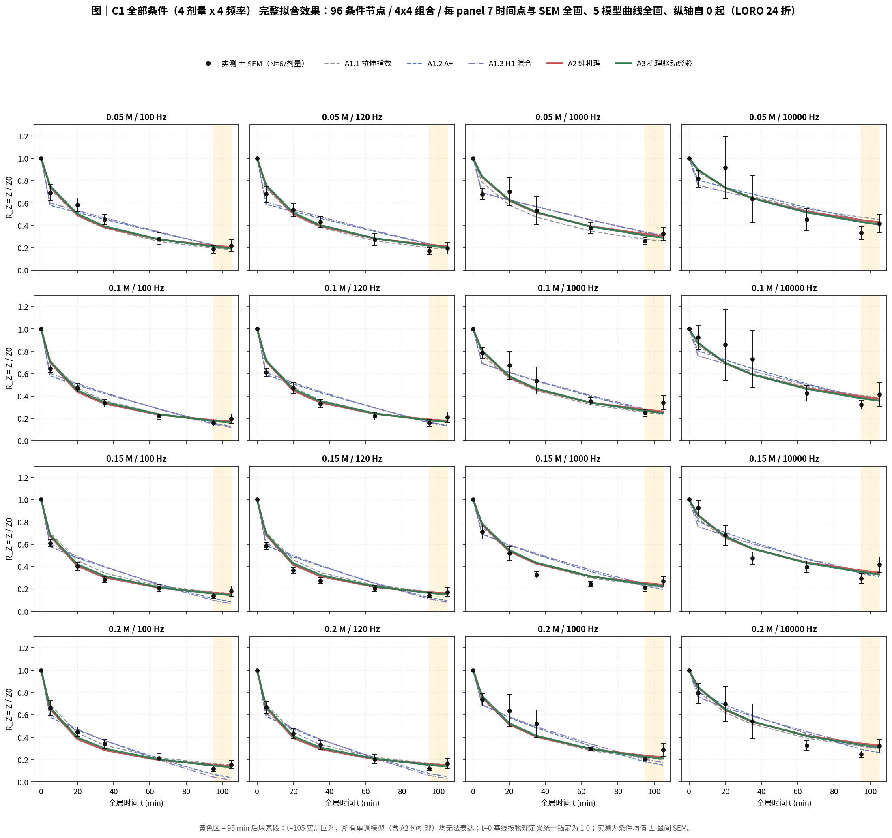

# Chemical Skull Modification & Stimulation Model

> 2026-11 重构：**TrackA 拆成三条平行路线**（纯经验 / 纯机理 / 机理驱动经验），
> 加 `TrackB` 校准预测区间。所有模型均为**矫正后**模型；未矫正的纯机理探索结果、
> 原始 LHS 结果、旧 `corrected_models/` 已从 main 移除（仍在 Git 历史，可恢复）。
> 拟合图放在 `four_conditions/figures/`（与前几轮位置一致）。

## 三条路线

| 路线 | 目录 | 内容 | 机理含量 |
|---|---|---|---|
| **TrackA1 纯经验** | `TrackA1/A1.1` `A1.2` `A1.3` | 拉伸指数 / A+ / H1 混合 | 无 / 低（机理先验作特征或骨架） |
| **TrackA2 纯机理** | `TrackA2/` | 并联导纳 + 脱钙动力学，**频率内生**，4 个全物理量参数，零经验回归层 | 100% |
| **TrackA3 机理驱动经验** | `TrackA3/` | A2 机理骨架 + 2 个受约束保形校准系数（eta=1,eps=0 退化为 A2） | 骨架 100% + 经验校准 |
| TrackB | `TrackB/` | 校准后的 LOO 预测区间（392 点全频 + 196 点低频） | 机理 ensemble + conformal padding |

## 四条件拟合（本次核心）

| 条件 | 剂量 | 频率 | 节点 | LORO 折数 |
|---|---|---|---:|---:|
| C1 全部 | 0.05/0.10/0.15/0.20 M | 100/120/1000/10000 Hz | 96 | 24 |
| C2 低频 | 4 剂量 | 100/120 Hz | 48 | 24 |
| C3 高浓度 | 0.15/0.20 M | 4 频率 | 48 | 12 |
| C4 低频 + 高浓度 | 0.15/0.20 M | 100/120 Hz | 24 | 12 |

**结论摘要**：把频率写进机理方程比在外面接经验回归更有效 ——
C1 全条件下 **A2 纯机理（4 参数、零经验层）LORO=0.486 反超三个纯经验模型**；
**A3 机理驱动经验四条件 LORO 全部第一**（0.520 / 0.733 / 0.641 / 0.768）。
样本内 full R2 最高的是纯曲线拟合（A1.1 在 C2/C4 达 0.962 / 0.982），
但那是收窄评价集 + 自由度带来的，不等于模型更好。
详见 `four_conditions/THREE_ROUTES_CONCLUSION.md` 与 `four_conditions/figures/fig10_table1.png`。

## 拟合效果图（完整：7 时间点 + SEM + 5 模型曲线全画、纵轴自 0 起）

| 图 | 内容 |
|---|---|
| `fig1_metrics_by_condition.png` | 四条件 x 五模型 full / LORO R2 |
| `fig2_fit_C1_all.png` | **C1 全部条件** 4x4=16 panel 完整拟合图 |
| `fig3_fit_C2_lowfreq.png` | **C2 低频** 4x2=8 panel 完整拟合图 |
| `fig4_fit_C3_highdose.png` | **C3 高浓度** 2x4=8 panel 完整拟合图 |
| `fig5_fit_C4_lf_hd.png` | **C4 低频+高浓度** 2x2=4 panel 完整拟合图 |
| `fig6_routes_loro.png` | 三路线五模型四条件 LORO 汇总 |
| `fig7_mechanism_surface.png` | A2 频率内生曲面（把频率算进机理的直接证据） |
| `fig8_architecture.png` | 三路线架构、机理含量与共享机理底座 |
| `fig9_trackB_four_conditions.png` | TrackB 四条件覆盖率 / 宽度 / Winkler |
| `fig10_table1.png` | 表1 四条件 x 五模型完整指标 |



## 口径声明（务必阅读）

1. **三条路线都是「有物理动机或数据动机的参数化」，不构成机理被证实**。
   A2 的物理参数由实测标定，不是从第一性原理推导；`s` 是等效频散指数，不是被辨识的 CPE 指数。
2. 验证层级：`full`（样本内）< `LOCO`（群体条件均值层）< **`LORO` 留一大鼠（个体级独立验证，验收口径）**。
   四条件评价集与 LORO 折数不同（C1/C2 为 24 折，C3/C4 为 12 折），**R2 不可横向比大小**。
3. **TrackB 只报 coverage / width / Winkler，不报 R2 / RMSE**；逐点覆盖率不等于整条曲线联合覆盖概率；
   区间宽度约 97% 来自 conformal padding，而非 LHS 参数不确定性。
4. **拟合变好 != 模型变好**：条件收窄、增加自由度、补协变量都会抬高 R2。
5. 基线 t=0 按物理定义 R_Z=1：A1.1 / A1.3 / A2 / A3 天然满足，**A1.2 (A+) 需人为锚定**。
6. 数据：修订版《体外EDTA数据记录汇总.xlsx》SHA `4c165298...`，三层核验见 `data/data_verification.json`。
   保留全部 24 鼠，**未删除 WT17 / WT9 / WT8 等不利样本**；14 处 urea_10/Midpoint/WT21-24 转录异常标记未决。

## OPEN ISSUES

- 尿素 t=105 回升：所有单调模型（含 A2 纯机理）均无法表达；需在机理层补界面重构 / 再封闭项。
- 真正修复脱钙动力学需用孔隙率 / 钙含量实测重标定 phi(t)；辨识 `s` 需独立宽频 EIS 介电谱实验。
- TrackB：验证集 22/24 鼠（缺 WT5 0.10 M、WT6 0.15 M）；0.05 M 存在 role x 剂量混淆；上游机制选择非严格嵌套。
- 本地 Excel SHA 与上游 manifest 声明的 source_data SHA 不一致，上游原始文件不可得。

## 复现

```bash
pip install -r requirements.txt
cd four_conditions
python run_three_routes.py    # 计算：四条件 x 五模型 full / LOCO / LORO + TrackB 切片
python make_figures.py        # 绘图：10 张图写入 figures/
```

每个 `model.py` 可独立 import 并调用 `predict(dose, t_min, freq_hz)`；
`TrackA2/model.py`、`TrackA3/model.py`、`TrackA1/A1.1/model.py` 完全自包含，不读外部文件。
