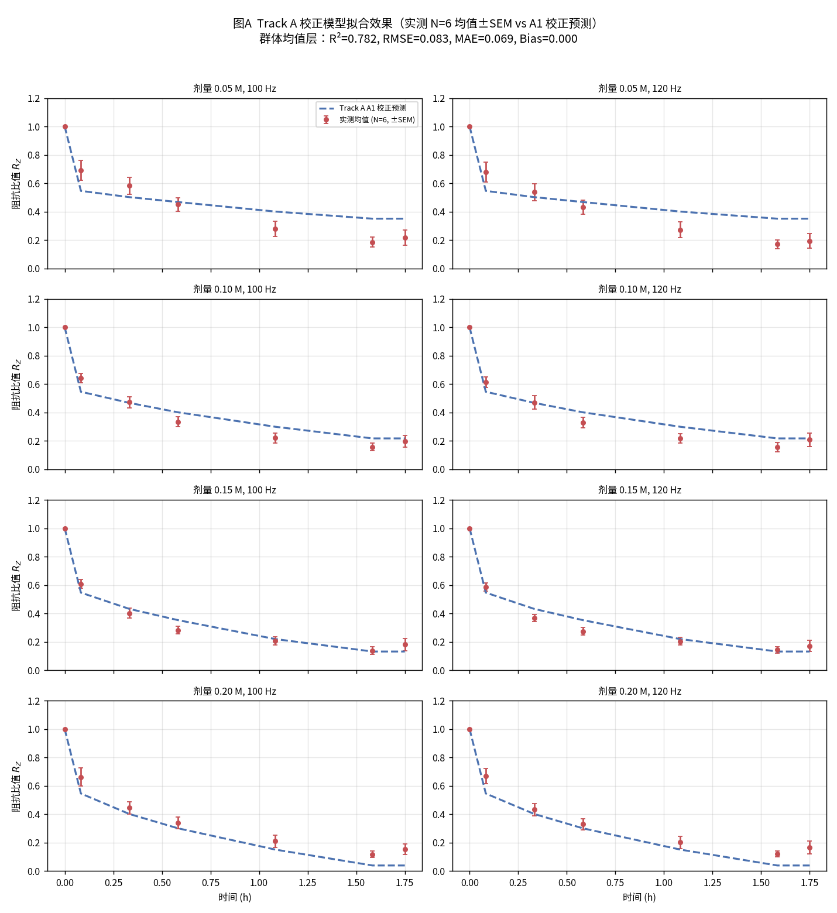
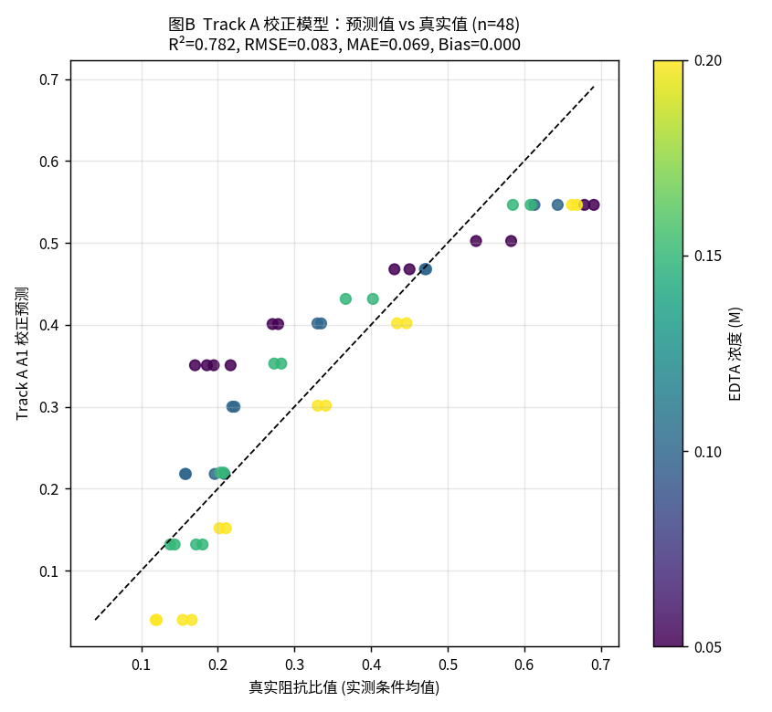
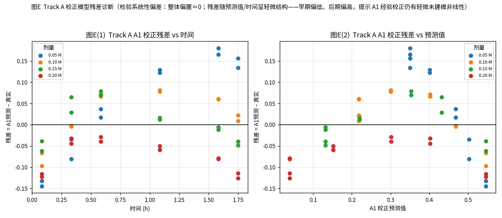
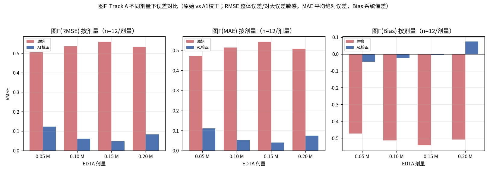
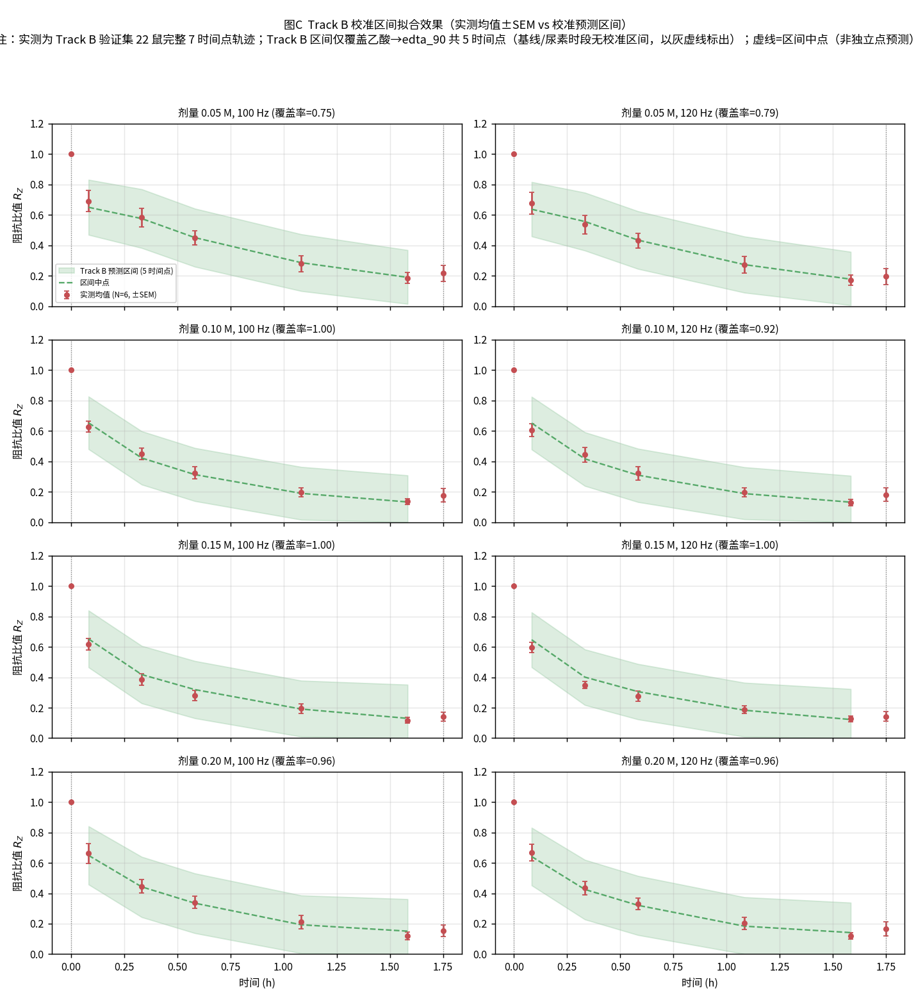
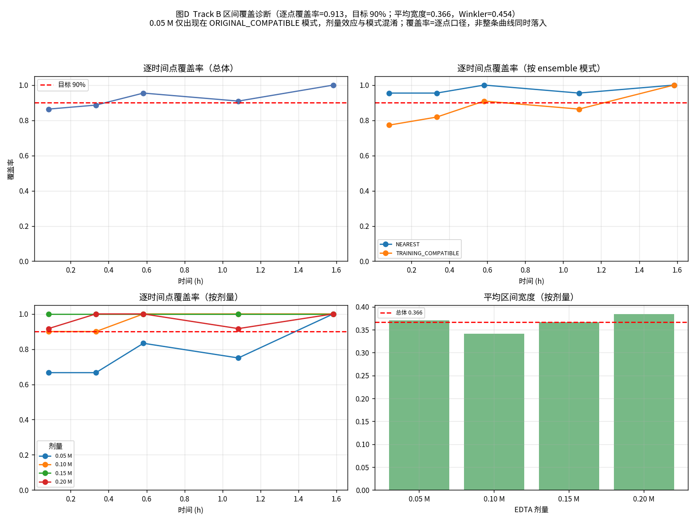
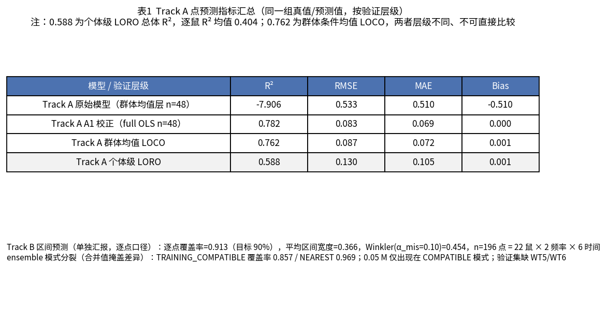

# Chemical Skull Modification Stimulation Model

SD 大鼠颅骨化学改性的三层理论模型，含体外阻抗趋势对照、平台绑定等效标定与留鼠内部验证。

> **2026 低频更新**：新增 [矫正后 TrackA (A1) 与 TrackB 校准区间模型](#lowfreq-corrected-models)，含 7 张拟合效果图与完整验证口径；下述原始机理主线与历史结果完整保留。

<a id="lowfreq-corrected-models"></a>

## 低频矫正后模型与拟合效果（100/120 Hz，TrackA A1 + TrackB 校准区间）

> 本轮内容位于 `corrected_models/`，为**纯新增**：不改动机理主线、不覆盖 A0 / B0 原始版本与任何历史结果，全部改动可追溯。原始模型 `σ = 1e-4 + 1.5·φ^m`、空间串联积分 `R = Σ Δx_i/(σ_i A_i)` 保持不变。

原始全频段模型在低频下存在**幅度系统性偏差**（A0 群体条件均值层 R² = −7.906、Bias = −0.510、Pearson r = 0.885：趋势相关但幅值失配）。本轮**仅在 100/120 Hz** 范围做双线修正，并补齐拟合效果图与验证口径：

- **Track A · A1 经验校正**：`R_Z_corr = a + b·R_Z_raw`，`a = −4.4715`、`b = 5.6806`（基线按物理定义锚定 `R_Z(t=0) = 1.0`）。**这是经验线性校正，不是机理改进**。
- **Track B · 嵌套校准区间**：保留 LHS 集成 + 22 折留一大鼠外层 × 5 折分组内层 conformal 校准；`lower = clip(q05 − p, 0, 1)`、`upper = clip(q95 + p, 0, 1)`，`p_(fold,f) = tolerance_f · q_f`，`q_f` 为内层交叉拟合分数的 0.90 分位数。**不报告 R²/RMSE**。

### 表 1　Track A 点预测指标汇总

| 模型 / 验证层级 | R² | RMSE | MAE | Bias |
|---|---:|---:|---:|---:|
| Track A 原始模型 A0（群体条件均值, n=48） | −7.906 | 0.533 | 0.510 | −0.510 |
| Track A A1 校正（full OLS, n=48） | 0.782 | 0.083 | 0.069 | 0.000 |
| Track A 群体均值 LOCO（留一条件外推） | 0.762 | 0.087 | — | — |
| Track A 个体级 LORO（留一大鼠外推） | 0.588\* | 0.130 | 0.105 | 0.000 |

\* 0.588 是**个体级 LORO 总体 R²**，逐鼠 R² 均值仅 **0.404**（WT17、WT2 为负）。0.762 是**群体条件均值**的 LOCO 结果——两者预测层级不同（单鼠外推 vs 群体均值），**不能表述为"性能从 0.762 下降到 0.588"**。所有 R² / RMSE / MAE 均基于同一组真值与预测值，并标注验证层级。实验为**被试间设计**（每鼠仅一种 EDTA 浓度，6 鼠/浓度）。

**Track B 区间预测（单独汇报，逐点口径，不与 Track A 的 R² 混比）**：逐点覆盖率 **0.913**（目标 0.90）、平均区间宽度 **0.366**、Winkler(α_mis = 0.10) **0.454**；n = 196 点 = 22 鼠 × 2 频率 × 5 个改性时间点（乙酸 → EDTA 90 min，**不含基线 t=0 与尿素 t=105**）。

| 分层 | 覆盖率 | 平均宽度 | n |
|---|---:|---:|---:|
| 总体 | 0.913 | 0.366 | 196 |
| TRAINING_COMPATIBLE_ENSEMBLE | 0.857 | 0.376 | 98 |
| NEAREST_TRAINING_ENSEMBLE（compatible_count=0 回退） | 0.969 | 0.356 | 98 |

- 合并覆盖率 0.913 **掩盖了两种 ensemble 模式的分裂**（一半欠覆盖、一半过保守）；B2 校准对照必须控制 `ensemble_role`。
- **0.05 M 剂量只出现在 TRAINING_COMPATIBLE 模式**（覆盖率 0.768），故"0.05 M 欠覆盖"实为**剂量—模式混淆**，不能解释为剂量效应。
- 区间宽度约 **97% 来自 conformal padding**，基础 LHS 参数不确定仅 ~3%：过宽根因是**校准层在补偿"仿真 vs 实测"的系统性偏差与个体差异**，不是参数采样不足，因此**不应扩大 LHS 采样范围**。
- 验证集为 **22/24 鼠**（缺 WT5 (0.10 M)、WT6 (0.15 M)）；WT17、WT9、WT8 等表现不佳个体**全部保留、不删除**。

### 拟合效果图（7 张）

全部图**纵坐标自 0 起**，实测为 **N = 6 均值 ± SEM**，**7 个时间点（基线 → 尿素）完整绘出**，无裁剪。

**图 A · Track A 校正模型拟合效果**（实测 ±SEM vs A1 校正预测，剂量 × 频率 8 面板）——模型能否跟踪阻抗随时间的下降趋势



**图 B · Track A 预测值 vs 真实值**（含 y = x 参考线与 R² / RMSE / MAE 标注）——预测与真实的一致程度



**图 E · Track A 残差诊断**（残差 vs 时间 / vs 预测值，均含 y = 0 参考线）——是否存在系统性偏差、误差是否随时间增大。残差并非完全无结构：早期偏低、后期偏高，提示 A1 经验校正仍有轻微未建模非线性。



**图 F · Track A 不同剂量误差对比**（RMSE / MAE / Bias，原始 vs A1，每剂量 n = 12）——避免总体误差掩盖条件级拟合问题



**图 C · Track B 校准区间拟合效果**（实测 ±SEM vs 校准预测区间阴影，剂量 × 频率 8 面板）——真实观测是否落入区间、区间是否过宽。实测画满 7 点完整轨迹；**校准区间仅在 Track B 验证覆盖的 5 个改性时间点叠加**，基线/尿素时段为灰虚线标注的"无区间"区，不视为模型失败。



**图 D · Track B 区间覆盖诊断**（逐时间点覆盖率 / 宽度：总体、按 ensemble 模式、按剂量，含 90% 目标线）——覆盖率是否稳定、宽度是否合理



**图 G · 表 1 指标汇总**（一页可汇报的性能口径）



### 口径声明与遗留问题

1. 误差棒为 **N = 6 均值 ± SEM**（实验观测的离散程度），**不等于**模型预测区间；区间中点是区间中点，**不是**独立的点预测结果。
2. Track B 的覆盖率是**逐点覆盖率**，**不是**整条时间曲线同时落入区间的概率。
3. **A1 是经验校正**，仅作工程预测对照，不构成机理改进；物理可解释的改进需 A2 参数敏感性实验与 A3 电学映射一致性审计。
4. 机制 `mechanism_id = 157` / `two_sided_50um` 由**全数据诊断选定**，未在每个外层训练折内重选，存在乐观偏差；严格折内验证（B3）待做。
5. 本地 Excel 与上游 manifest 声明的 SHA 不一致、原始文件不可得；权威冻结数据为 24 鼠 `measured` CSV（含 SHA-256 清单与 14 处异常 / 32 条重复记录核查报告）。
6. 以上均为**内部留鼠验证**，不是独立外部验证。

完整口径见 [`corrected_models/README.md`](corrected_models/README.md)；验证报告见 [`corrected_models/validation/`](corrected_models/validation/)（A1 大鼠级 LORO、TrackB B1 区间误差诊断、数据差异报告、拟合结论、复现脚本）。

---

## 快速开始

### 在线交互网页（推荐）
直接打开 GitHub Pages 上的参数化仿真页面：

https://yanqing-huang.github.io/Chemical-Skull-Modification-Stimulation-Model/

所有参数（频率、试剂类型、浓度、浸泡时间、几何、孔隙率、动力学、电学）实时可调节，点击"运行仿真"即可看到脱钙与阻抗响应。

### 本地 Python 仿真
```bash
pip install -r requirements.txt
python run_simulation.py          # 生成理论先验结果（CSV + 图）
python run_prior_mechanism.py     # Track A：200 条文献先验 LHS 轨迹
python run_equivalent_calibration.py --data /本地路径/体外EDTA数据记录汇总.xlsx
python run_multifrequency_calibration.py --data /本地路径/体外EDTA数据记录汇总.xlsx  # B v3：四频主分析+全冻存敏感性
python run_trend_comparison.py    # Track A × 实测低频阻抗趋势对照
# 当前 B1：R_Z 嵌套校准区间；公开机制输入不含原始实验数据
python run_interval_prediction.py --target ratio --mechanism-id 157 --workers 2 \
  --predictions results/track_b_interval_rz/mechanism157_condition_predictions.csv \
  --data /本地路径/体外EDTA数据记录汇总.xlsx \
  --output results/track_b_interval_rz/calibrated_interval
# 当前 B2：ΔZ 嵌套校准区间（MΩ）
python run_interval_prediction.py --target delta --mechanism-id 19 --workers 2 \
  --predictions results/track_b_interval_delta_z/mechanism19_condition_predictions.csv \
  --data /本地路径/体外EDTA数据记录汇总.xlsx \
  --output results/track_b_interval_delta_z/calibrated_interval
python -m unittest discover -s tests -v   # 77 项单元测试
# 低频（100/120 Hz）矫正后模型，纯新增，可独立运行自检
python corrected_models/trackA_A1/model.py          # Track A：A1 经验校正
python corrected_models/trackB_calibrated/model.py  # Track B：校准区间查询
```

## 模型结构

### 三层颅骨（一维厚度方向）
- 外板（密质骨）~0.43 mm
- 板障（松质骨）~0.20 mm
- 内板（密质骨）~0.17 mm

### 三步时序化学改性
1. **50% 乙酸预处理**（300 s）——酸溶解初步脱钙
2. **EDTA 螯合**（90 min，浓度扫描；15/15/30/30 min 分段换新液）——主脱钙阶段
3. **饱和尿素**（10 min）——溶胀，不消耗固相钙

### 控制方程（多孔介质）
$$\frac{\partial(\varepsilon c_j)}{\partial t} = \frac{\partial}{\partial x}\left(D_{e,j}\frac{\partial c_j}{\partial x}\right) - \nu_j k_{r,j} c_j q_j$$

- $D_e = D_{\text{bulk}} \varepsilon / \tau$（有效扩散系数，已含孔隙率）
- 固相钙守恒：$\partial q / \partial t = -k_r c q$
- 孔隙率演化：$\varepsilon = \varepsilon_0 + \alpha (q_0 - q)$
- 50% 乙酸仅接触外板（外侧 Robin BC、内侧零通量）；EDTA 和尿素完全浸没，内外表面均为 Robin BC
- Archie 型电阻率：$\sigma = \sigma_m + \sigma_f \varepsilon^m$

### 诊断量
- Thiele 模数 $\phi = h \sqrt{k_r q_0 / D_e}$
- 有效因子 $\eta = \tanh(\phi) / \phi$
- Biot 数 $\text{Bi} = k_f h / D_e$

## 项目结构

```
├── parameters/theoretical_prior.json    # SD 大鼠推测先验参数（含不确定度范围）
├── cranial_model/
│   ├── core.py                           # 三层有限体积求解器（浸没/单侧边界、SCM、分层 k_r、EDTA 位点容量）
│   ├── diagnostics.py                    # SCM 解析验证 + Thiele/Biot
│   ├── ensemble.py                       # LHS 采样与集成预测
│   ├── experimental.py                   # 实测阻抗谱读取
│   ├── equivalent_calibration.py         # B v2：双分支观测算子、等效标定、留鼠验证、残差诊断
│   ├── multifrequency_calibration.py     # B v3：四频观测层、分块评分、逐频容差与留鼠验证
│   ├── near_surface.py / site_geometry.py # 近表面状态、三位点几何与曲面守恒
│   ├── diploe_polarization.py            # 保历史的板障串联极化状态
│   ├── frequency_surface_polarization.py # 13/17/19 参数频率—表面—极化观测模型
│   ├── delta_z_calibration.py            # 同鼠同位点同频 ΔZ 目标、容差与评分
│   ├── interval_prediction.py            # 集成区间与分组交叉一致性校准
│   └── plotting.py                       # SCI 风格作图
├── run_simulation.py                     # Python 仿真入口
├── run_prior_mechanism.py                # A 主线：文献先验 LHS 机理集成（不用实测数据调参）
├── run_equivalent_calibration.py         # B v2：基质+界面双分支标定、留鼠验证与界面份额分解
├── run_multifrequency_calibration.py     # B v3：复用 v2 轨迹的四频主分析与全冻存敏感性分析
├── run_trend_comparison.py               # A×实测 Z_ratio 趋势对照（非校准）
├── run_frequency_surface_polarization.py # 原 R_Z 点值全数据可达性诊断
├── run_frequency_surface_loo.py          # 原 R_Z 19 参数逐折独立留鼠验证
├── run_delta_z_calibration.py / run_delta_z_loo.py # ΔZ 可达性与基础留鼠诊断
├── run_interval_prediction.py            # B1/B2 共用的嵌套校准区间入口
├── calibrate.py                          # 后续体外数据校准入口
├── examples/experimental_data_template.csv
├── tests/                                # 77 项单元测试
├── results/                              # 理论结果、去标识化实测目标与验证输出
│   ├── prior_mechanism/                  # A 主线集成输出
│   ├── equivalent_calibration_v2/        # B v2：双分支等效标定输出
│   ├── multifrequency_calibration_v3/    # B v3：22 只四频主分析输出
│   ├── multifrequency_calibration_v3_all24_sensitivity/ # B v3：24 只全冻存敏感性输出
│   ├── track_b_interval_rz/              # 原 R_Z 点值对照与 B1 校准区间
│   ├── track_b_interval_delta_z/         # B2 ΔZ 诊断、基础留鼠与校准区间
│   └── trend_comparison/                 # 趋势对照输出
├── index.html                           # 在线交互仿真（轻量近似，定量以 Python 为准）
└── corrected_models/                    # 低频 100/120 Hz 矫正后模型（纯新增，不改动机理主线）
    ├── README.md                        # 完整口径声明
    ├── trackA_A1/                       # A1 经验校正：model.py / parameters.json / 指标 CSV
    ├── trackB_calibrated/               # 嵌套校准区间：model.py / parameters.json / 区间 CSV
    ├── data/                            # 冻结 24 鼠数据 + SHA-256 清单 + 机理先验 CSV
    ├── figures/                         # 7 张拟合效果图（figA–figG）
    └── validation/                      # A1 LORO / B1 诊断 / 数据差异 / 拟合结论 / 复现脚本
```

## 当前理论预测（EDTA 浓度扫描，30 min）

| EDTA 浓度 | 全颅骨钙剩余 | 基质面积电阻比（模型） |
|-----------|-------------|----------------------|
| 0.05 mol/L| 94.85%      | 0.772                |
| 0.10 mol/L| 93.97%      | 0.741                |
| 0.15 mol/L| 93.27%      | 0.719                |
| 0.20 mol/L| 92.66%      | 0.704                |

**以上均为待校准理论预测，不是实验结果。**

## 真实数据对照与验证范围

### 数据与质控

- 原始工作簿：24 只大鼠、432 个频谱、1728 行频率测量，频率为 100/120/1000/10000 Hz；源文件 SHA-256 为 `486ec7e995944a814d23f6ecec995c20b716dbfe143519cc9e5fbcb39d18b056`。
- B v2 的验证目标是 100/120 Hz 的 `Z_post/Z_baseline`：先逐部位、逐频率相对自身基线，再在大鼠内平均 3 个部位和 2 个频率。B v3 改为在 100/120/1000/10000 Hz **分别构建目标**，每个大鼠×条件×频率只平均 3 个部位，禁止跨频平均。
- 主分析按实验备注剔除冻存、乙醇+尿素处理等混杂测量，排除 22 个大鼠-条件；最终为 **22 只大鼠、每频 98 个目标**。因此 v2 为 98 行、每行 6 个低频比值，v3 为 392 行、每行 3 个同频比值。
- 0.15 和 0.20 mol/L 的 90 min 条件各只有 1 只大鼠，不贡献条件 SD，但仍纳入评分并单独标记。留鼠验证属于**内部验证**，不是独立外部验证。
- 考虑到 -20°C 冻存后解冻及 PBS 清洗未必造成显著改变，后文分别保留 v2 的 WT5/WT6 敏感性分析，并新增 v3 的**全部冻存记录恢复**敏感性分析；二者都不覆盖主分析口径。
- 上传的历史体外分析支持现行乙酸预处理、15/15/30/30 min EDTA 分段测量和 PBS 清洗流程，也显示 1000/10000 Hz 同样下降但幅度较小。其“85%饱和”与“<0.4%/min”定义不一致，均未设为拟合目标。
- 原始 Excel 和内部分析 docx 不纳入仓库；公开内容仅为代码、去标识化大鼠级目标/预测结果和源数据哈希。

### 当前 Track B：保留原点值结论，B1/B2 评价校准预测区间

原任务与区间任务不互相替代。原 Track B 的目标是同大鼠、同位点、同频率的 $R_Z=Z_{post}/Z_0$ 点值兼容，不是绝对阻抗 $Z$；位点比值随后在大鼠内平均。当前可复现的 19 参数机制 157 全数据 DE 可达性为 `minimax=1.000335`，且当前扩展时间边界下的 22 折逐折独立 DE 留鼠仍有 **10/22 空兼容折**，故原点值任务未通过。空折覆盖率记 NA，不记为 0；该结果与 B1 的 17 参数训练集成空折数是不同模型和采样规则下的指标，不能混用。见 [全数据诊断](results/track_b_interval_rz/v5b_time_best_observation_two_sided_50um_summary.json) 和 [原点值留鼠汇总](results/track_b_interval_rz/original_point_loo/loo_overall.json)。

修订版把研究问题改为：**在已知新大鼠自身基线和实验流程时，预测改性阻抗变化的范围**。B1 是主要结果，B2 是绝对变化量敏感性分析；二者不是原 Track B 的通过证明，也不是两份独立验证证据，因为 $\Delta Z=Z_0(R_Z-1)$。

| 内部 22 折留鼠结果 | B1：$R_Z$，17 参数机制 157 | B2：$\Delta Z$，17 参数机制 19 |
|---|---:|---:|
| 校准后总体经验点覆盖率 | **90.82%**（356/392） | **90.31%**（354/392） |
| 中位区间宽度 | 0.44996 | 13.46721 MΩ |
| 最大区间宽度 | 1.76634 | 34.43616 MΩ |
| 逐鼠最低／中位覆盖率 | 65%／95% | 70%／91.875% |
| 100 Hz 覆盖率 | 91.84% | 90.82% |
| 120 Hz 覆盖率 | 90.82% | 91.84% |
| 1000 Hz 覆盖率 | 90.82% | 90.82% |
| 10000 Hz 覆盖率 | 89.80% | 87.76% |

最终区间是**名义 90% 逐点预测区间**，不是均值置信区间、整条曲线同步置信带或 90% 点预测准确率。训练集成先产生 5/50/95% 分位数；每个外层训练集内部再以五折分组交叉一致性校准逐频扩展，外层留出鼠只参与最终评价。$R_Z$ 下限施加物理非负截断；$\Delta Z$ 可以为负，不作该截断。B1 原点值任务的空折结论不被此区间结果改写。

原始参数集成区间明显过窄：B1/B2 的原始中位宽度分别约为 0.0061 和 2.106 MΩ，校准后增至 0.4500 和 13.467 MΩ。这说明参数兼容集成本身不足以覆盖跨鼠误差；90% 总体覆盖部分由较宽区间实现，因此当前更适合趋势与范围估计，而非精细点值预测。逐鼠和 10 kHz 结果也未全部达到 90%。

上述结果为**内部验证**。机制与结构选择参考过全数据诊断，模型选择没有完全被嵌套在外层训练折内；在用于确认性推断前，应锁定机制和流程并以新大鼠作独立外部验证。B2 使用留出鼠自身基线将共同 $R_Z$ 预测转换为 $\Delta Z$，因此不是对未知基线大鼠绝对 $Z$ 的无条件预测。完整输出见 [B1 总体指标](results/track_b_interval_rz/calibrated_interval/loo_interval_overall.json)、[B1 留出点区间](results/track_b_interval_rz/calibrated_interval/loo_calibrated_point_intervals.csv)、[B2 总体指标](results/track_b_interval_delta_z/calibrated_interval/loo_interval_overall.json) 和 [B2 留出点区间](results/track_b_interval_delta_z/calibrated_interval/loo_calibrated_point_intervals.csv)。源数据、机制输入、代码和结果哈希见 [验证清单](results/track_b_validation_manifest.json)。

### Track A：文献先验机理与实测趋势

四个 EDTA 浓度的实测条件均值和仿真中位数均单调下降，各浓度的 Spearman ρ 均为 1.0；但实测总降幅为 0.485–0.617，纯基质模型仅为 0.034–0.089。因此只能认定**趋势方向一致**，不能认定幅值吻合或本征动力学参数得到验证。钙剩余量、脱钙深度以及 PLV/SNR 不在本次实测验证范围内。

### Track B v2：低频双分支等效标定（未通过）

预设兼容阈值为条件间大鼠 SD 的 RMS，即 0.10328。同一批 98 个目标上的结果为：

| 候选空间 | 候选数 | 兼容数 | 最佳 RMSE |
|---|---:|---:|---:|
| Track A 文献先验纯基质 | 200 | 0 | 0.25399 |
| 阶段边界修正后的等效纯基质 | 200 | 0 | 0.11826 |
| 基质+外表面界面双分支 | 3200 | 0 | 0.10987 |

界面分支较相同 200 条纯基质轨迹的最佳 RMSE 进一步降低 0.00839（7.1%），但仍高于兼容阈值 0.00659。**22/22 个留鼠折均为空兼容集**，所以覆盖率和区间宽度不可定义，而不是“覆盖率为 0%”。最佳 5% 候选的全数据探索性点覆盖为 62.2%，不是独立验证证据；残差随 EDTA 时间显著漂移（Spearman ρ=-0.635，p=7.09×10⁻¹⁰），触发结构失配标记。

因此当前模型**未通过实测幅值与留鼠内部验证，不能作为已验证预测工具**；兼容集为空，也不报告界面份额。完整数值见 [B v2 指标](results/equivalent_calibration_v2/equivalent_calibration_metrics.json)、[留鼠汇总](results/equivalent_calibration_v2/loo_rat_summary.csv) 和 [残差诊断](results/equivalent_calibration_v2/FigB2_residual_drift.png)。

### B v2 的 24 只敏感性分析：仅纳入 WT5/WT6

使用 `--retain-confounded-rats WT5 WT6` 仅恢复这两只大鼠，其他日期/条件下有混杂标记的 12 个目标仍剔除，得到 **24 只、108 个目标**。这检验的是“冻存后解冻+PBS清洗可接受”的假设；原记录还含“乙醇+尿素处理”，所以本分析不能单独证明所有预处理均无影响，也不替代主分析。

| 指标 | 主分析：22 只 | 敏感性分析：24 只 |
|---|---:|---:|
| 目标数 | 98 | 108 |
| 兼容阈值 | 0.10328 | 0.10457 |
| 纯基质最佳 RMSE | 0.11826 | 0.11487 |
| 双分支最佳 RMSE | 0.10987 | 0.10750 |
| 双分支完整数据兼容数 | 0/3200 | 0/3200 |
| 残差-EDTA时间 Spearman ρ | -0.635 | -0.600 |

纳入后双分支最佳 RMSE 改善 2.15%，但仍高于阈值，且残差漂移仍显著（p=1.66×10⁻⁹）。留鼠分析中 **22/24 折为空**；WT1、WT14 两折各只有 1 个兼容候选，覆盖率为 0%、区间宽度为 0，属于单点退化区间而非有效验证。因此“模型未通过实测幅值及内部验证”的结论不变。完整结果见 [24 只敏感性指标](results/equivalent_calibration_v2_all24_sensitivity/equivalent_calibration_metrics.json) 和 [留鼠汇总](results/equivalent_calibration_v2_all24_sensitivity/loo_rat_summary.csv)。

### Track B v3：四频幅值观测层（仍未通过）

v3 复用 v2 的同一 200 条机制轨迹，每条增加 32 组三参数 LHS，共 6400 个复合候选；不重跑 PDE，也不让频率改变脱钙动力学。观测算子为：

$$Z_f/Z_{f0}=(1-\beta_f)R_{\rm matrix}+\beta_f\phi_{\rm surface}^{-m},\qquad \beta_{10000}=q\beta_{100}$$

其中 $\beta_{100}\in[0.3,0.95]$、$0<q<1$、$m\in[0.5,3]$，$\operatorname{logit}(\beta_f)$ 沿 $\log_{10}(f)$ 在 100 与 10000 Hz 端点间线性插值，因此等效界面权重随频率不增加。$\beta_f$ 只是平台绑定的等效混合权重，不是真实界面面积或因果份额。

每个频率独立由训练大鼠估计噪声；乙酸只在噪声估计时跨未来 EDTA 剂量合并。主分析四个容差为：

| 频率 | 100 Hz | 120 Hz | 1000 Hz | 10000 Hz |
|---|---:|---:|---:|---:|
| 容差 | 0.09917 | 0.10011 | 0.21597 | 0.40919 |

兼容必须同时满足总标准化 RMSE≤1 和每频 raw RMSE≤对应容差，避免 10 kHz 的大容差掩盖低频失配。同一 392 个目标上的结果为：

| 观测结构 | 候选数 | 兼容数 | 最佳总标准化 RMSE | 100 Hz raw | 120 Hz raw | 1000 Hz raw | 10000 Hz raw |
|---|---:|---:|---:|---:|---:|---:|---:|
| 纯基质 | 200 | 0 | 1.13583 | 0.12000 | 0.11990 | 0.23328 | 0.42815 |
| 四频双分支 | 6400 | 0 | 1.05888 | 0.11382 | 0.11633 | 0.20787 | 0.38625 |

各 raw 列对应“总标准化 RMSE 最佳”的候选。四频观测层使该指标较纯基质下降 6.77%，但仍未通过；100/120 Hz 的全空间逐频最优 raw RMSE 也分别只有 0.11286/0.11633，仍高于各自容差，故这两个频率均为 **0/6400 通过**。1000/10000 Hz 分别有 35/6400、1837/6400 个候选通过单频门槛，但不能抵消低频失败。

**22/22 个留鼠折均为空兼容集**，392 个留出点的预测均不可用，覆盖率和区间宽度为 NA。最佳 5% 最近邻包络仅作诊断，点覆盖 64.5% 不是验证证据。逐频 EDTA 时间残差诊断如下；100/120/1000 Hz 触发预设 $|\rho|>0.4$ 且 p<0.05 的漂移标记，10 kHz 未触发该标记，但仍不能据此认定模型通过。

| 频率 | Spearman ρ | p 值 | 漂移标记 |
|---|---:|---:|---|
| 100 Hz | -0.649 | 2.38×10⁻¹⁰ | 是 |
| 120 Hz | -0.589 | 2.14×10⁻⁸ | 是 |
| 1000 Hz | -0.478 | 1.24×10⁻⁵ | 是 |
| 10000 Hz | -0.311 | 0.00631 | 否 |

v2 的 0.10987 是“100/120 Hz 合并后”的 raw RMSE，v3 的 1.05888 是“四频分别归一化后”的 RMSE，二者数值不能直接比较。可在同一数据口径内比较的是：v2 的双分支相对其纯基质基线，以及 v3 的四频观测层相对其纯基质基线；392→480 行的变化则只来自冻存记录纳入口径，不是模型结构改善。

### B v3 全冻存敏感性分析：24 只、480 行

该分析恢复全部冻存标记记录，而非只恢复 WT5/WT6，得到 24 只、每频 120 个目标。它仅检验“全部冻存记录可接受”的假设；原记录还含乙醇+尿素处理，不能据此证明预处理无影响，也不替代 22 只主分析。

| 指标 | 主分析：22 只 | 全冻存敏感性：24 只 |
|---|---:|---:|
| 四频目标数 | 392 | 480 |
| 四频容差（100/120/1000/10000 Hz） | 0.09917 / 0.10011 / 0.21597 / 0.40919 | 0.09692 / 0.09747 / 0.19986 / 0.36706 |
| 纯基质最佳总标准化 RMSE | 1.13583 | 1.12135 |
| 四频双分支最佳总标准化 RMSE | 1.05888 | 1.05466 |
| 双分支最佳候选四频 raw RMSE | 0.11382 / 0.11633 / 0.20787 / 0.38625 | 0.10760 / 0.10982 / 0.19415 / 0.36772 |
| 完整数据兼容数 | 0/6400 | 0/6400 |
| 留鼠空折 | 22/22 | 24/24 |

恢复全部记录后结论不变。完整数值见 [B v3 主分析指标](results/multifrequency_calibration_v3/multifrequency_calibration_metrics.json)、[主分析逐频漂移](results/multifrequency_calibration_v3/residual_drift_by_frequency.csv)、[全冻存敏感性指标](results/multifrequency_calibration_v3_all24_sensitivity/multifrequency_calibration_metrics.json) 和 [敏感性逐频漂移](results/multifrequency_calibration_v3_all24_sensitivity/residual_drift_by_frequency.csv)。当前结果只说明既定轨迹与观测参数空间内的探索性筛选，不支持本征 $R_0$、界面因果份额或已验证预测能力的主张。

## 其他观测的后续校准

若获得钙释放曲线、脱钙深度、micro-CT 孔隙率或独立阻抗数据集，可运行：

```bash
python calibrate.py --data 实验数据.csv --fit stages.edta.k_r_m3_per_mol_s
```

输出"理论先验 vs 校准后"逐点对照表。

## 方法学说明

### 参数来源边界
- 人体颅骨论文提供**结构方法和分层测量**，**不能**直接迁移数值给 SD 大鼠；
- 固定化反应工程 PPT 提供 **$D_e$ / Thiele / Biot / 有效因子** 的方法论；
- 所有 SD 大鼠的分层厚度、孔隙率、钙含量、反应速率必须标为"推测先验"，保留不确定度范围。

### 频率的使用
- 脱钙过程本身与频率无关；
- 频率仅作用于电学读出层；
- 4–30 Hz SSVEP 频段（吴小明论文定性）呈阻性，采用准静态电导率近似；
- 不能仅凭体积传导模型预测 PLV 或直接证明 SNR 提升。

### 边界条件
- 50% 乙酸仅接触外板：`stages.acetic_acid.boundary_mode=outer_only`，内侧零通量；
- EDTA 和尿素阶段为离心管完全浸没：`stages.edta.boundary_mode=immersed`、`stages.urea.boundary_mode=immersed`，外板和内板均接触同一药液；
- 体内外板涂抹情景：将相应阶段设为 `outer_only`，内侧零通量；
- 若研究脑脊液/脑组织暴露效应，必须新增 CSF 和脑组织域，不能继续用零通量代替组织域。
- 模型保留乙酸→EDTA 的顺序、15/15/30/30 min 换液、测量前 PBS 清洗和固相状态历史；17 参数主线移除的只是额外经验时间弛豫项，并非移除机理时间动力学。
- 参数文件记录乙酸 1 mL 和 EDTA 25/25/50/50 mL，但当前求解器采用固定主体浓度边界，`bath_volume_ml` **尚未进入有限浴液体积消耗方程**。机理轨迹可连续求解，阻抗则仅在实验测量时刻接受验证，不能把测量点之间的曲线称为已被连续实验验证。

### Track B v2 解读边界
- 每条机理轨迹使用 16 组条件 LHS 界面参数（默认 200×16=3200 个复合候选），不增加正向仿真次数；纯基质基线仍使用原始 200 条轨迹。
- 复合动力学参数及界面参数 $\beta,m$ 仅适用于当前测量平台，不是羟基磷灰石本征动力学，不可迁移到其他电极平台。
- 界面份额是全数据兼容集上的描述性分解，不是后验概率或独立验证的因果份额；预测性能须另看留鼠覆盖率和区间宽度。
- Track A 不用实测阻抗调参，与实测低频阻抗仅作趋势级对照。

### Track B v3 解读边界
- 每条机制轨迹使用 32 组 $\beta_{100},q,m$ LHS；纯基质对照仍为同一 200 条轨迹，评分、容差和留鼠规则与四频版本一致。
- 频率只改变观测层的等效权重，不改变乙酸/EDTA 边界、钙反应或孔隙率轨迹。
- 总标准化评分之外还设置逐频 raw RMSE 门槛；空留鼠折记 NA，单候选零宽区间记退化，均不能包装成验证成功。
- 即使后续出现兼容候选，也仅为当前平台的探索性等效描述；不能据此识别本征 $R_0$、固有动力学或真实界面份额。

## 验证

- 液相质量守恒最大相对误差 < 3×10⁻¹⁰；钙守恒最大绝对残差 < 8×10⁻¹⁴ mol/m²
- 基准网格相对细网格：EDTA 末钙总量差 0.0046%，面积电阻差 0.0143%
- 时间步收敛（20 s 相对 5 s）：钙总量与面积电阻相对差均 < 10⁻⁸%
- 77 项单元测试全过（含无反应极限、SCM 解析验证、曲面体积守恒、分层 k_r、板障极化、B1/B2 区间校准及历史 B v2/v3 回归）
- B v3 独立复算评分最大差约 3.6×10⁻¹⁵；34 个输出文件完整复跑逐字节一致，记录的输入哈希全部匹配
- 网页用于轻量交互演示；定量结果以 Python 参考输出为准

## 参考文献

1. 林婧璇. 现生人群颅骨骨壁厚度多维度研究与古人类演化启示.
2. 刘澳. 考虑颅骨力学性能增龄改变的人体头部建模与应用.
3. 吴小明. 人颅骨电阻抗频率特性及其与解剖结构关系研究.
4. 生物反应工程与设备（第三章固定化生物催化剂）.
