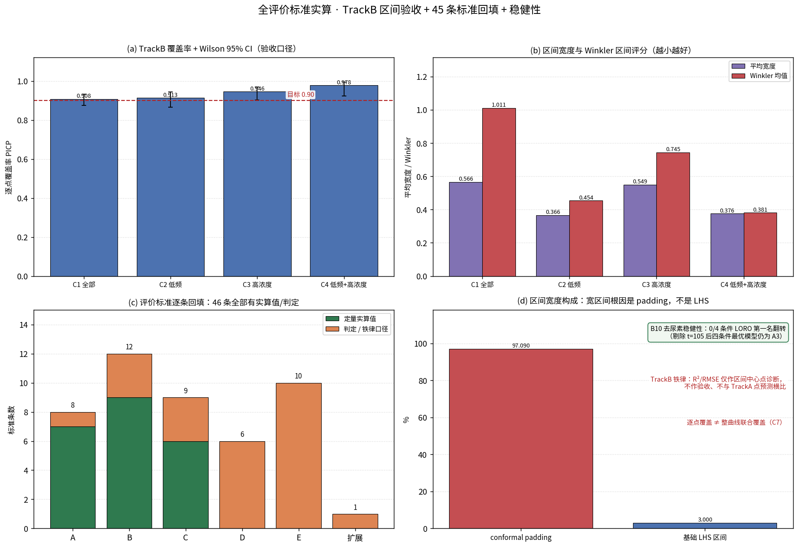

# Chemical Skull Modification & Stimulation Model

> 2026-11 重构：**TrackA 拆成三条平行路线**（纯经验 / 纯机理 / 机理驱动经验），
> 加 `TrackB` 校准预测区间。所有模型均为**矫正后**模型；未矫正的纯机理探索结果、
> 原始 LHS 结果、旧 `corrected_models/` 已从 main 移除（仍在 Git 历史，可恢复）。
> 拟合图放在 `four_conditions/figures/`（与前几轮位置一致）。

## 三条路线

| 路线 | 目录 | 内容 | 机理含量 |
|---|---|---|---|
| **TrackA1 纯经验** | `TrackA1/A1.1` `A1.2` `A1.3` | 拉伸指数 / A+ / H1 混合 | 无 / 低（机理先验作特征或骨架） |
| **TrackA2 纯机理** | `TrackA2/` | 并联导纳 + 脱钙动力学，**频率内生**，4 个全物理量参数，零经验回归层 | 100% |
| **TrackA3 机理驱动经验** | `TrackA3/` | A2 机理骨架 + 2 个受约束保形校准系数（eta=1,eps=0 退化为 A2） | 骨架 100% + 经验校准 |
| TrackB | `TrackB/` | 校准后的 LOO 预测区间（392 点全频 + 196 点低频） | 机理 ensemble + conformal padding |

## 机理模型原理（必读 · 本轮新增）

**唯一权威总纲：[`docs/MECHANISM_PRINCIPLE.md`](docs/MECHANISM_PRINCIPLE.md)** —— 把此前 121 行的「机理+经验」概览
扩充为**逐条、逐模型**的完整原理总纲，覆盖所有含机理成分的模型：TrackA1（A1.2 / A1.3）、TrackA2、TrackA3、TrackB。


| 原理 | 内容 | 对应模型 |
|---|---|---|
| 一 EDTA 脱钙化学 | 羟基磷灰石 + EDTA 螯合 Ca → 孔隙率 `phi` 上升 | 全部（物理起点） |
| 二 Archie 电导 | `sigma = sigma_floor + c·phi^m`，符号与量纲 | 机理先验 / A2 |
| 三 串联积分与归一化 | `R = Σ dx/(sigma·A)`、`R_Z = Z/Z0`、`t=0≡1`；旧机理三个结构性缺口 | 全部 |
| 四 界面极化 / CPE 并联导纳 | `Y = G_ion(t,d) + G_pol(f)`，解释「高频 `R_Z` 系统性偏高」 | A2 / A1.3 |
| 五 `delta_eff` 完整推导 | `Y(0)/Y(t) → 1/(1+delta_eff)`；4 个物理量 + 3 个参考标度 + 数学性质 | A2 |
| 六 参数可辨识性 | `G0` 与 `rho` 尺度冗余 → 6→5→4 参数 → 边界命中诊断 | A2 / A3 / A1 系列 |
| 七 逐模型机理溯源 | 每个模型的机理输入、来源、经验层、自包含性 | A1.1 / A1.2 / A1.3 / A2 / A3 / TrackB |
| 八 落盘数值对照 | 四条件 LORO / A2 跨条件零重拟合迁移 / TrackB 区间指标 | 全部 |
| 九 诚实边界 | 标定≠第一性原理、`s` 非被辨识 CPE 指数、尿素回升、padding 97% | 全部 |

总纲**附录 A 是符号与量纲总表**；所有数值由 `four_conditions/make_mechanism_principles.py` 从落盘结果自动渲染，
**未重新拟合、未改模型**。四个模型 README 也各带「本模型涉及的机理原理」摘要 ——
**机理模型涉及的原理在 TrackA 与 TrackB 目录层面也都写进去了**。

> 关键澄清：严格链条是「CPE 旁路导纳随 `f` 上升 → 分母 `(G0+G_pol)` 变大 → `delta_eff` 被稀释 →
> `delta_eff ∝ f^(-s)`」；早期概览把 `G_pol(f) ~ (f/F0)^(-s)` 作为等效简写，已在总纲 5.1 节补全推导。

## 评价标准与验收口径（必读 · 本轮新增）

**唯一权威清单：[`docs/EVALUATION_CRITERIA.md`](docs/EVALUATION_CRITERIA.md)** —— 把此前散落在 README 口径声明、
结论文档、机理原理、各模型 README 与 `validation/` 留痕里的评价标准**全部收拢、逐条定义，
并给出 TrackA1（A1.1 / A1.2 / A1.3）、TrackA2、TrackA3、TrackB 每个模型在每一条标准下的数值**。
所有数值由 `four_conditions/make_evaluation_criteria.py` 从落盘结果自动渲染，未重新拟合、未改模型。


| 标准类 | 条目 | 覆盖对象 | 核心内容 |
|---|---|---|---|
| **A 类** 验证层级与数据切分 | 8 | TrackA / TrackB | `full` < `LOCO` < **LORO（唯一验收口径）**；折数、评价集规模、数据版本 gate、不利样本保留 |
| **B 类** 点预测指标 | 12 | **A1.1 / A1.2 / A1.3 / A2 / A3** | R² / RMSE / MAE / bias / AIC / k / 基线 t=0 / 参数可辨识性 / 物理可解释性 / 去尿素稳健性 / 跨条件零重拟合迁移 / 自包含性 |
| **C 类** 区间指标 | 9 | **TrackB** | coverage / width（均值·中位·最大）/ Winkler / padding 占比 / 逐点≠联合 / 无区间时段 / padding 公式；**不报 R² / RMSE** |
| **D 类** 绘图验收 | 6 | 全部拟合图 | 7 时间点 + SEM 全画、纵轴自 0 起、5 条模型曲线全画、无遮挡无缺字、位置一致 |
| **E 类** 判定铁律 | 10 | 全部结论 | 不可横比 / 收窄≠变好 / 拟合≠机理 / 指标≠可用 / 噪声级 / 多重比较 / 逐鼠方差 / 尿素回升 / s 非被辨识 / 不构成机理被证实 |

总纲第 3 节是**五个 TrackA 模型各一张完整数值矩阵**（全 24 列指标 × 四条件），
第 4 节是**逐模型成绩单**（每条标准逐项判读与硬伤），第 5 节是 A2 跨条件零重拟合迁移证据，
第 6 节是 **TrackB 四条件区间指标与达标判读**，第 7 节是验收流程。
各模型 README 也带本模型的成绩单摘要 —— **TrackA 与 TrackB 都已写进去**。

## 四条件拟合（本次核心）

| 条件 | 剂量 | 频率 | 节点 | LORO 折数 |
|---|---|---|---:|---:|
| C1 全部 | 0.05/0.10/0.15/0.20 M | 100/120/1000/10000 Hz | 96 | 24 |
| C2 低频 | 4 剂量 | 100/120 Hz | 48 | 24 |
| C3 高浓度 | 0.15/0.20 M | 4 频率 | 48 | 12 |
| C4 低频 + 高浓度 | 0.15/0.20 M | 100/120 Hz | 24 | 12 |

**结论摘要**：把频率写进机理方程比在外面接经验回归更有效 ——
C1 全条件下 **A2 纯机理（4 参数、零经验层）LORO=0.486 反超三个纯经验模型**；
**A3 机理驱动经验四条件 LORO 全部第一**（0.520 / 0.733 / 0.641 / 0.768）。
样本内 full R2 最高的是纯曲线拟合（A1.1 在 C2/C4 达 0.962 / 0.982），
但那是收窄评价集 + 自由度带来的，不等于模型更好。
详见 `four_conditions/THREE_ROUTES_CONCLUSION.md` 与 `four_conditions/figures/fig10_table1.png`。

## 拟合效果图（完整：7 时间点 + SEM + 5 模型曲线全画、纵轴自 0 起）

| 图 | 内容 |
|---|---|
| `fig1_metrics_by_condition.png` | 四条件 x 五模型 full / LORO R2 |
| `fig2_fit_C1_all.png` | **C1 全部条件** 4x4=16 panel 完整拟合图 |
| `fig3_fit_C2_lowfreq.png` | **C2 低频** 4x2=8 panel 完整拟合图 |
| `fig4_fit_C3_highdose.png` | **C3 高浓度** 2x4=8 panel 完整拟合图 |
| `fig5_fit_C4_lf_hd.png` | **C4 低频+高浓度** 2x2=4 panel 完整拟合图 |
| `fig6_routes_loro.png` | 三路线五模型四条件 LORO 汇总 |
| `fig7_mechanism_surface.png` | A2 频率内生曲面（把频率算进机理的直接证据） |
| `fig8_architecture.png` | 三路线架构、机理含量与共享机理底座 |
| `fig9_trackB_four_conditions.png` | TrackB 四条件覆盖率 / 宽度 / Winkler |
| `fig10_table1.png` | 表1 四条件 x 五模型完整指标 |
| **`fig11_evaluation_criteria.png`** | **评价标准与验收口径总览**（验证层级 / 5 类标准清单 / 五模型 x 四条件 LORO 达标矩阵） |
| **`fig12_mechanism_principles.png`** | **机理模型原理总览**（6 步机理链路 / 并联等效电路 / 频率内生曲线 / 参数量纲表） |


## 口径声明（务必阅读 · 细则）

> 以下是最常用的 6 条速记；**完整定义、公式、优先级、口径出处与逐模型数值见
> [`docs/EVALUATION_CRITERIA.md`](docs/EVALUATION_CRITERIA.md)**（A / B / C / D / E 五类共 45 条标准）。

1. **三条路线都是「有物理动机或数据动机的参数化」，不构成机理被证实**。
   A2 的物理参数由实测标定，不是从第一性原理推导；`s` 是等效频散指数，不是被辨识的 CPE 指数。
2. 验证层级：`full`（样本内）< `LOCO`（群体条件均值层）< **`LORO` 留一大鼠（个体级独立验证，验收口径）**。
   四条件评价集与 LORO 折数不同（C1/C2 为 24 折，C3/C4 为 12 折），**R2 不可横向比大小**。
3. **TrackB 只报 coverage / width / Winkler，不报 R2 / RMSE**；逐点覆盖率不等于整条曲线联合覆盖概率；
   区间宽度约 97% 来自 conformal padding，而非 LHS 参数不确定性。
4. **拟合变好 != 模型变好**：条件收窄、增加自由度、补协变量都会抬高 R2。
5. 基线 t=0 按物理定义 R_Z=1：A1.1 / A1.3 / A2 / A3 天然满足，**A1.2 (A+) 需人为锚定**。
6. 数据：修订版《体外EDTA数据记录汇总.xlsx》SHA `4c165298...`，三层核验见 `data/data_verification.json`。
   保留全部 24 鼠，**未删除 WT17 / WT9 / WT8 等不利样本**；14 处 urea_10/Midpoint/WT21-24 转录异常标记未决。

> 五个 TrackA 模型的完整数值矩阵（总纲第 3 节）、逐模型成绩单（第 4 节）、
> TrackB 区间达标判读（第 6 节）与验收流程（第 7 节）见
> [`docs/EVALUATION_CRITERIA.md`](docs/EVALUATION_CRITERIA.md)。

## OPEN ISSUES

- 尿素 t=105 回升：所有单调模型（含 A2 纯机理）均无法表达；需在机理层补界面重构 / 再封闭项。
- 真正修复脱钙动力学需用孔隙率 / 钙含量实测重标定 phi(t)；辨识 `s` 需独立宽频 EIS 介电谱实验。
- TrackB：验证集 22/24 鼠（缺 WT5 0.10 M、WT6 0.15 M）；0.05 M 存在 role x 剂量混淆；上游机制选择非严格嵌套。
- 本地 Excel SHA 与上游 manifest 声明的 source_data SHA 不一致，上游原始文件不可得。

## 复现

```bash
pip install -r requirements.txt
cd four_conditions
python run_three_routes.py          # 计算：四条件 x 五模型 full / LOCO / LORO + TrackB 切片
python make_figures.py              # 绘图：fig1-fig10 写入 figures/
python make_evaluation_criteria.py   # 评价标准总纲 EVALUATION_CRITERIA.md + fig11
python make_mechanism_principles.py  # 机理模型原理总纲 MECHANISM_PRINCIPLE.md + fig12
```

每个 `model.py` 可独立 import 并调用 `predict(dose, t_min, freq_hz)`；
`TrackA2/model.py`、`TrackA3/model.py`、`TrackA1/A1.1/model.py` 完全自包含，不读外部文件。

<!-- ALL_METRICS_COMPUTED -->
## 全评价标准实算（本轮新增 · R² / RMSE / 残差等等全部算成数值）

上一轮把 **45 条评价标准写进来**（[`docs/EVALUATION_CRITERIA.md`](docs/EVALUATION_CRITERIA.md)），
本轮把其中**每一条可计算的标准真正算出数值**：

**唯一权威数值总表：[`docs/ALL_METRICS_COMPUTED.md`](docs/ALL_METRICS_COMPUTED.md)**

- **60 组 × 75 个指标**：5 模型 × 4 条件 × 3 验证层级（`ALL_METRICS_FULL.csv`）
- **8640 行逐点残差**：每个观测点的观测/预测/残差/标准化残差（`RESIDUALS_LONG.csv`）
- **残差诊断全套**：分布、Shapiro–Wilk、Jarque–Bera、Durbin–Watson、异方差、离群点、分组偏差
- **45 条标准逐条回填**（`STANDARDS_COMPUTED.csv`）+ **E 类铁律数值证据**（`IRONLAW_EVIDENCE.csv`）
- **补算 B10 去尿素稳健性**：0/4 条件 LORO 第一名翻转
- **一致性校验 PASS**：60 项复算与冻结值 max absΔR² = 4.777e-07，证明零改动




| 新增文件 | 内容 |
|---|---|
| `four_conditions/ALL_METRICS_FULL.csv` | 全指标主表 |
| `four_conditions/RESIDUALS_LONG.csv` | 逐点残差 |
| `four_conditions/RESIDUAL_GROUP_DIAGNOSTICS.csv` | 分组残差诊断 |
| `four_conditions/PER_RAT_LORO_R2.csv` | 逐鼠 LORO R² |
| `four_conditions/STANDARDS_COMPUTED.csv` | 45 条标准回填 |
| `four_conditions/IRONLAW_EVIDENCE.csv` | 铁律数值证据 |
| `four_conditions/B10_DROP_UREA.csv` | 去尿素稳健性 |
| `four_conditions/TRACKB_FULL_METRICS.csv` | TrackB 全套 + 诊断性点指标 |
| `four_conditions/TRACKB_STRATIFIED.csv` | TrackB 分层覆盖率 |
| `four_conditions/CONSISTENCY_CHECK.csv` | 冻结值逐项比对 |
| `four_conditions/compute_all_metrics.py` | 可复现计算脚本 |

复现：
```bash
cd four_conditions
python compute_all_metrics.py        # 全套指标（不改模型，含一致性校验）
python make_all_metrics_figures.py   # fig13 / fig14 / fig15
python make_all_metrics_docs.py      # 渲染 ALL_METRICS_COMPUTED.md
```

> **TrackB 口径**：区间中心的 R² / RMSE / 残差已全部算出（总表第 6.2 节），
> 但标注 `DIAGNOSTIC_ONLY`；验收仍以 coverage / width / Winkler 为准，铁律不变。
